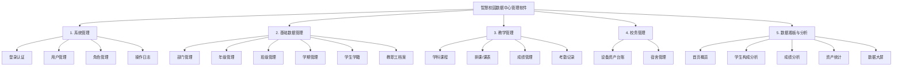
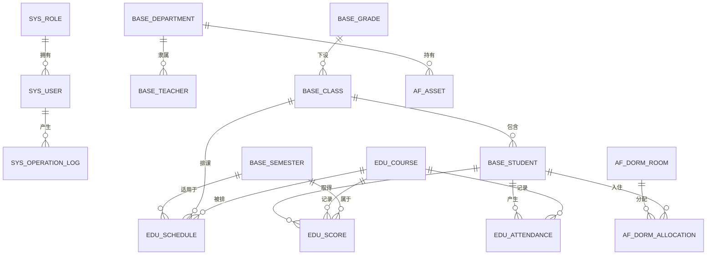

# 智慧校园数据中心管理软件 —— 业务设计概要

> 版本：v1.2
> 用途：作为后续编码、**软件著作权（软著）源代码**、**操作手册**及**操作手册截图**的统一依据。
> 说明：本概要只定"做什么、怎么做、做出什么"，不写具体代码实现。

---

## 一、项目定位

| 项目 | 内容 |
| --- | --- |
| 软件名称 | 智慧校园数据中心管理软件 |
| 客户对象 | **小学、初中、高中**（基础教育阶段学校，含九年一贯制、完全中学、十二年一贯制） |
| 核心价值 | 把学校分散在各处的学生、教职工、教学、校务数据统一收口到一个平台，做到"一处录入、集中管理、可视化呈现" |
| 使用角色 | 系统管理员、教务管理员、班主任、任课教师、总务管理员 |
| 界面语言 | 简体中文 |

**一句话描述**：一套给中小学用的数据管理后台，管住人（学生/教职工）、管住事（课程/成绩/考勤）、管住物（资产/宿舍），并把结果用图表和大屏展示出来。

**业务术语对照**（这是与高校版最大的区别，编码时一律按右列用词）：

| 通用说法 | 本软件用词 | 说明 |
| --- | --- | --- |
| 院系 / 学院 | 部门 / 教研组 | 教务处、德育处、总务处、办公室，以及语文组、数学组等教研组 |
| 专业 | 年级 | 一年级 ~ 六年级、初一 ~ 初三、高一 ~ 高三，共 12 个年级 |
| 班级 | 班级 | 如"高一(3)班"，挂在年级之下 |
| 课程 | 学科课程 | 语文、数学、英语、物理、化学…… |
| 考试类型 | 月考 / 期中 / 期末 / 单元测 | — |
| 辅导员 | 班主任 | — |

---

## 二、技术方案

### 2.1 技术栈

| 层次 | 选型 | 说明 |
| --- | --- | --- |
| 前端框架 | Vue 3 + TypeScript | 组合式 API（`<script setup>`） |
| 前端构建 | Vite | 开发热更新、生产打包 |
| UI 组件库 | Element Plus | 表格、表单、弹窗、菜单等，内置中文语言包 |
| 前端路由 | Vue Router | 路由 + 登录守卫 |
| 前端状态 | Pinia | 只存登录用户信息与令牌 |
| 前端请求 | Axios | 统一封装、统一拦截器 |
| 图表 | ECharts | 数据看板与大屏 |
| 后端框架 | FastAPI | 异步框架，自动生成接口文档 |
| 数据校验 | Pydantic v2 | 请求/响应模型 |
| ORM | SQLAlchemy 2.0 | 表模型与查询 |
| 数据库 | PostgreSQL | 唯一数据存储 |
| 认证 | JWT（python-jose + passlib/bcrypt） | 账号密码登录 |
| 运行方式 | uvicorn（后端）+ vite（前端） | 本地直跑，不涉及容器 |

### 2.2 关键取舍说明

- **不用 Redis**：本软件为单机运行的业务管理系统，登录令牌采用无状态 JWT，不需要服务端会话；看板数据直接查库即可。引入 Redis 只会增加部署难度，对软著无增益。
- **不用 Docker**：直接本地启动，降低运行门槛。
- **不做代码生成**：前后端接口契约由**后端 Pydantic 模型**作为唯一事实源，FastAPI 自动产出接口文档（`/docs`）；前端手写一份对齐的 `src/types/api.ts`。不做 OpenAPI → TS 的自动化生成。
- **契约共享的真相**：Python 无法直接 `import` TypeScript 文件，因此不存在"物理共享的类型文件"。前后端共享的是**同一份接口约定**，而非同一份代码。前端 `types` 与后端 `schemas` 字段名、类型一一对应，改动时同步修改。

### 2.3 仓库结构（Monorepo，前后端分离）

```
smart-campus-dc/
├── frontend/                     # 前端工程（Vue 3 + TS + Vite）
│   ├── src/
│   │   ├── api/                  # 按模块封装的接口调用
│   │   ├── assets/               # 静态资源
│   │   ├── components/           # 公共组件（分页表格、搜索栏等）
│   │   ├── router/               # 路由与登录守卫
│   │   ├── stores/               # Pinia（登录用户、令牌）
│   │   ├── types/                # api.ts 接口类型定义
│   │   ├── utils/                # axios 封装、工具函数
│   │   ├── views/                # 页面（按模块分目录）
│   │   ├── App.vue
│   │   └── main.ts
│   ├── index.html
│   ├── package.json
│   ├── tsconfig.json
│   └── vite.config.ts
├── backend/                      # 后端工程（FastAPI）
│   ├── app/
│   │   ├── routers/              # 按模块分的路由
│   │   ├── config.py             # 配置（数据库连接、密钥）
│   │   ├── database.py           # 引擎、会话
│   │   ├── models.py             # SQLAlchemy 表模型
│   │   ├── schemas.py            # Pydantic 请求/响应模型
│   │   ├── security.py           # 密码加密、JWT 签发校验
│   │   ├── deps.py               # 公共依赖（当前用户等）
│   │   ├── init_data.py          # 初始化演示数据
│   │   └── main.py               # 应用入口
│   ├── requirements.txt
│   └── .env.example
├── docs/                         # 设计概要、操作手册、截图
│   ├── 设计概要.md
│   ├── 操作手册.md
│   └── screenshots/
└── README.md
```

> 分层说明：**不做** service / repository / dto 等进一步拆分。路由函数内直接调用 ORM 完成业务，保持文件数量少、代码可读、便于截图与软著排版。

---

## 三、功能结构（5 大模块）



### 3.1 模块一：系统管理

| 子功能 | 内容 | 关键操作 |
| --- | --- | --- |
| 登录认证 | 账号密码登录，签发 JWT；令牌失效需重新登录；退出登录 | 登录、退出、修改密码 |
| 用户管理 | 系统账号维护，绑定教职工、分配角色、启用/停用 | 新增、编辑、重置密码、启用禁用、查询 |
| 角色管理 | 角色定义与权限标识（系统管理员/教务/班主任/任课教师/总务） | 新增、编辑、删除、查询 |
| 操作日志 | 记录谁在什么时间做了什么操作 | 查询、按时间/操作人筛选 |
| 登录日志 | 记录登录账号、时间、IP、结果 | 查询、筛选 |

### 3.2 模块二：基础数据管理

| 子功能 | 内容 |
| --- | --- |
| 部门管理 | 行政科室（教务处、德育处、总务处、办公室）与教研组（语文组、数学组……），含类型、负责人、联系电话 |
| 年级管理 | 一年级 ~ 高三共 12 个年级，含所属学段（小学/初中/高中）、年级组长、年级序号 |
| 班级管理 | 班级挂在年级下，含班级名称、教室、班主任、班级人数 |
| 学期管理 | 学年学期维护（如"2025-2026学年第一学期"），标记当前学期 |
| 学生学籍 | 学籍号、姓名、曾用名、性别、民族、出生日期、身份证件号、政治面貌、联系电话、现居住地址、所属班级、入学年份、就读方式（走读/住校）、学籍状态；家庭信息含父亲与母亲各自的姓名、身份证件号、工作单位、职务、联系电话 |
| 教职工档案 | 工号、姓名、性别、所属部门、任教学科、职称、联系电话、邮箱、入职时间、在职状态 |

### 3.3 模块三：教学管理

| 子功能 | 内容 |
| --- | --- |
| 学科课程 | 课程代码、课程名称、适用学段、开课教研组、周课时、课程性质（必修/选修/活动）、任课教师 |
| 排课/课表 | 课程 + 班级 + 学期 + 星期 + 节次 + 教室；支持按班级、按教师查看周课表 |
| 成绩管理 | 按学生 + 课程 + 学期 + 考试类型录入成绩；支持按班级批量录入与查询 |
| 考勤记录 | 按学生 + 课程 + 日期记录考勤状态（正常/迟到/早退/缺勤/请假） |

### 3.4 模块四：校务管理

| 子功能 | 内容 |
| --- | --- |
| 设备资产台账 | 资产编号、名称、分类（多媒体设备/计算机/实验器材/图书/体育器材/课桌椅/办公设备）、品牌型号、金额、购置日期、所属部门、保管人、状态（在用/闲置/维修/报废）、存放地点 |
| 宿舍管理 | 宿舍楼/房间号/床位数/已住人数/性别类型；住宿分配记录（学生 + 房间 + 床位 + 入住日期 + 状态） |

### 3.5 模块五：数据看板与分析

| 子功能 | 内容 |
| --- | --- |
| 首页概览 | 在校学生数、教职工数、班级数、资产总值等指标卡片 + 近 6 个学期平均分趋势 |
| 学生构成分析 | 按学段、按年级、按性别的占比饼图/柱状图 |
| 成绩分析 | 按学科统计平均分、及格率、优秀率、分数段分布 |
| 资产统计 | 按分类、按部门统计资产数量与金额 |
| 数据大屏 | 一块深色全屏看板，聚合上述图表，用于展示 |

---

## 四、角色与权限

| 角色 | 权限范围 |
| --- | --- |
| 系统管理员 | 全部模块 |
| 教务管理员 | 基础数据 + 教学管理（不含系统管理） |
| 班主任 | 基础数据只读 + 所带班级的成绩与考勤 + 本班学生学籍维护 |
| 任课教师 | 基础数据只读 + 所任课程的成绩录入与考勤登记 |
| 总务管理员 | 校务管理 + 基础数据只读 |

> 实现方式：登录后返回角色标识，后端在每个路由上做角色校验，前端根据角色控制菜单显示。

---

## 五、数据库设计

### 5.1 实体关系（ER）



### 5.2 数据表清单（共 17 张）

| 序号 | 表名 | 中文名 | 所属模块 |
| --- | --- | --- | --- |
| 1 | `sys_user` | 系统用户表 | 系统管理 |
| 2 | `sys_role` | 角色表 | 系统管理 |
| 3 | `sys_operation_log` | 操作日志表 | 系统管理 |
| 4 | `sys_login_log` | 登录日志表 | 系统管理 |
| 5 | `base_department` | 部门/教研组表 | 基础数据 |
| 6 | `base_grade` | 年级表 | 基础数据 |
| 7 | `base_class` | 班级表 | 基础数据 |
| 8 | `base_semester` | 学期表 | 基础数据 |
| 9 | `base_student` | 学生学籍表 | 基础数据 |
| 10 | `base_teacher` | 教职工表 | 基础数据 |
| 11 | `edu_course` | 学科课程表 | 教学管理 |
| 12 | `edu_schedule` | 排课表 | 教学管理 |
| 13 | `edu_score` | 成绩表 | 教学管理 |
| 14 | `edu_attendance` | 考勤表 | 教学管理 |
| 15 | `af_asset` | 资产表 | 校务管理 |
| 16 | `af_dorm_room` | 宿舍房间表 | 校务管理 |
| 17 | `af_dorm_allocation` | 住宿分配表 | 校务管理 |

### 5.3 主要表字段

**base_grade 年级表**

| 字段 | 类型 | 说明 |
| --- | --- | --- |
| id | bigint / 主键 | 自增主键 |
| name | varchar(20) | 年级名称：一年级……高三 |
| code | varchar(20) / 唯一 | 年级编码 |
| stage | varchar(10) | 所属学段：小学/初中/高中 |
| grade_level | int | 年级序号 1~12 |
| head_teacher_id | bigint / 外键 | 年级组长 |
| created_at | timestamp | 创建时间 |

**base_student 学生学籍表**

| 字段 | 类型 | 说明 |
| --- | --- | --- |
| id | bigint / 主键 | 自增主键 |
| student_no | varchar(32) / 唯一 | 学籍号（19 位，G/L 开头） |
| name | varchar(50) | 姓名 |
| used_name | varchar(50) | 曾用名 |
| gender | varchar(4) | 性别 |
| nation | varchar(20) | 民族 |
| birth_date | date | 出生日期 |
| id_card | varchar(20) | 身份证件号（演示数据脱敏） |
| political_status | varchar(16) | 政治面貌：少先队员/共青团员/群众 |
| phone | varchar(20) | 联系电话 |
| address | varchar(200) | 现居住地址 |
| class_id | bigint / 外键 | 所属班级 |
| enroll_year | int | 入学年份 |
| study_mode | varchar(10) | 就读方式：走读/住校 |
| status | varchar(16) | 学籍状态：正常/休学/转学/退学/毕业 |
| father_name | varchar(50) | 父亲姓名 |
| father_id_card | varchar(20) | 父亲身份证件号（演示数据脱敏） |
| father_work_unit | varchar(100) | 父亲工作单位 |
| father_position | varchar(50) | 父亲职务 |
| father_phone | varchar(20) | 父亲联系电话 |
| mother_name | varchar(50) | 母亲姓名 |
| mother_id_card | varchar(20) | 母亲身份证件号（演示数据脱敏） |
| mother_work_unit | varchar(100) | 母亲工作单位 |
| mother_position | varchar(50) | 母亲职务 |
| mother_phone | varchar(20) | 母亲联系电话 |
| created_at | timestamp | 创建时间 |

> 共 25 个字段（含主键与创建时间）。实际学籍表还有"是否留守儿童/随迁子女/残疾"等统计标记字段，本软件按标准版范围**不收录**，后续如需可再加。

**edu_score 成绩表**

| 字段 | 类型 | 说明 |
| --- | --- | --- |
| id | bigint / 主键 | 自增主键 |
| student_id | bigint / 外键 | 学生 |
| course_id | bigint / 外键 | 学科课程 |
| semester_id | bigint / 外键 | 学期 |
| exam_type | varchar(16) | 考试类型：月考/期中/期末/单元测 |
| score | numeric(5,2) | 成绩（百分制） |
| remark | varchar(200) | 备注 |
| created_at | timestamp | 创建时间 |

**af_asset 资产表**

| 字段 | 类型 | 说明 |
| --- | --- | --- |
| id | bigint / 主键 | 自增主键 |
| asset_no | varchar(32) / 唯一 | 资产编号 |
| name | varchar(100) | 资产名称 |
| category | varchar(32) | 分类：多媒体设备/计算机/实验器材/图书/体育器材/课桌椅/办公设备 |
| brand | varchar(50) | 品牌 |
| model | varchar(50) | 型号 |
| price | numeric(12,2) | 金额 |
| purchase_date | date | 购置日期 |
| department_id | bigint / 外键 | 所属部门 |
| keeper | varchar(50) | 保管人 |
| status | varchar(16) | 状态：在用/闲置/维修/报废 |
| location | varchar(100) | 存放地点 |
| created_at | timestamp | 创建时间 |

> 其余表字段在编码阶段按同一规范补齐，命名统一：主键 `id`，外键 `xxx_id`，时间 `created_at`/`updated_at`，状态字段用 `status`。

---

## 六、接口设计

### 6.1 统一约定

| 项 | 约定 |
| --- | --- |
| 前缀 | `/api/v1` |
| 认证 | 除登录外，所有接口需在 Header 携带 `Authorization: Bearer <token>` |
| 分页参数 | `page`（页码，从 1 开始）、`page_size`（每页条数，默认 10） |
| 分页返回 | `{ "total": 100, "items": [...] }` |
| 统一响应 | 成功直接返回数据体；失败返回 `{ "detail": "错误说明" }`，配合 HTTP 状态码 |
| 关键字查询 | 统一使用 `keyword` 参数，后端对主要文本字段做模糊匹配 |

### 6.2 接口清单（按模块）

**认证 / 系统管理**

| 方法 | 路径 | 说明 |
| --- | --- | --- |
| POST | `/api/v1/auth/login` | 登录，返回 token 与用户信息 |
| GET | `/api/v1/auth/profile` | 获取当前登录用户信息 |
| POST | `/api/v1/auth/change-password` | 修改密码 |
| GET/POST/PUT/DELETE | `/api/v1/users` | 用户管理 |
| PUT | `/api/v1/users/{id}/reset-password` | 重置密码 |
| GET/POST/PUT/DELETE | `/api/v1/roles` | 角色管理 |
| GET | `/api/v1/logs/operation` | 操作日志分页列表 |
| GET | `/api/v1/logs/login` | 登录日志分页列表 |

**基础数据管理**

| 方法 | 路径 | 说明 |
| --- | --- | --- |
| GET/POST/PUT/DELETE | `/api/v1/departments` | 部门/教研组管理 |
| GET/POST/PUT/DELETE | `/api/v1/grades` | 年级管理 |
| GET/POST/PUT/DELETE | `/api/v1/classes` | 班级管理 |
| GET/POST/PUT/DELETE | `/api/v1/semesters` | 学期管理 |
| GET/POST/PUT/DELETE | `/api/v1/students` | 学生学籍 |
| GET | `/api/v1/students/{id}` | 学生详情 |
| GET/POST/PUT/DELETE | `/api/v1/teachers` | 教职工档案 |

**教学管理**

| 方法 | 路径 | 说明 |
| --- | --- | --- |
| GET/POST/PUT/DELETE | `/api/v1/courses` | 学科课程 |
| GET/POST/PUT/DELETE | `/api/v1/schedules` | 排课 |
| GET | `/api/v1/schedules/timetable` | 按班级/教师查看周课表 |
| GET/POST/PUT/DELETE | `/api/v1/scores` | 成绩管理 |
| POST | `/api/v1/scores/batch` | 成绩批量录入 |
| GET/POST/PUT/DELETE | `/api/v1/attendances` | 考勤记录 |

**校务管理**

| 方法 | 路径 | 说明 |
| --- | --- | --- |
| GET/POST/PUT/DELETE | `/api/v1/assets` | 资产台账 |
| GET/POST/PUT/DELETE | `/api/v1/dorm-rooms` | 宿舍房间 |
| GET/POST/PUT/DELETE | `/api/v1/dorm-allocations` | 住宿分配 |

**数据看板**

| 方法 | 路径 | 说明 |
| --- | --- | --- |
| GET | `/api/v1/dashboard/overview` | 首页指标卡数据 |
| GET | `/api/v1/dashboard/student-composition` | 学生构成分析 |
| GET | `/api/v1/dashboard/score-analysis` | 成绩分析 |
| GET | `/api/v1/dashboard/asset-statistics` | 资产统计 |
| GET | `/api/v1/dashboard/screen` | 数据大屏聚合数据 |

---

## 七、页面清单（软著截图来源）

| 序号 | 页面 | 菜单路径 | 主要元素 |
| --- | --- | --- | --- |
| 1 | 登录页 | — | 账号/密码输入、登录按钮、系统名称 |
| 2 | 首页概览 | 首页 | 指标卡 + 趋势图 |
| 3 | 数据大屏 | 数据看板 → 数据大屏 | 全屏图表 |
| 4 | 学生构成分析 | 数据看板 → 学生构成 | 饼图 + 柱状图 |
| 5 | 成绩分析 | 数据看板 → 成绩分析 | 及格率、优秀率、分数段分布 |
| 6 | 资产统计 | 数据看板 → 资产统计 | 分类统计图表 |
| 7 | 用户管理 | 系统管理 → 用户管理 | 搜索栏 + 表格 + 新增弹窗 |
| 8 | 角色管理 | 系统管理 → 角色管理 | 表格 + 弹窗 |
| 9 | 操作日志 | 系统管理 → 操作日志 | 表格 + 时间筛选 |
| 10 | 登录日志 | 系统管理 → 登录日志 | 表格 + 时间筛选 |
| 11 | 部门管理 | 基础数据 → 部门管理 | 表格 + 弹窗 |
| 12 | 年级管理 | 基础数据 → 年级管理 | 表格 + 弹窗 |
| 13 | 班级管理 | 基础数据 → 班级管理 | 表格 + 弹窗 |
| 14 | 学期管理 | 基础数据 → 学期管理 | 表格 + 弹窗 |
| 15 | 学生学籍 | 基础数据 → 学生管理 | 列表（核心列：学籍号/姓名/性别/年级班级/学籍状态）+ 详情抽屉（展示全部 25 个字段，含父母信息）+ 新增/编辑弹窗（分组表单：基础信息 / 学籍信息 / 家庭信息） |
| 16 | 教职工档案 | 基础数据 → 教职工管理 | 表格 + 弹窗 |
| 17 | 学科课程 | 教学管理 → 课程管理 | 表格 + 弹窗 |
| 18 | 排课管理 | 教学管理 → 排课管理 | 表格 + 周课表视图 |
| 19 | 成绩管理 | 教学管理 → 成绩管理 | 表格 + 批量录入 |
| 20 | 考勤记录 | 教学管理 → 考勤记录 | 表格 + 状态标签 |
| 21 | 资产台账 | 校务管理 → 资产管理 | 表格 + 弹窗 |
| 22 | 宿舍管理 | 校务管理 → 宿舍管理 | 房间表格 + 分配记录 |
| 23 | 个人中心 | 右上角头像 | 个人信息 + 修改密码 |

> 截图清单即操作手册的章节骨架：每个页面 = 操作手册的一节 = 一张或多张截图。

---

## 八、软著材料对应关系

**重要：软著只提交 1 份源代码 + 1 份操作手册**，前后端代码合并在同一份源代码文档中，不分开申报。

| 软著材料 | 本项目对应产出 |
| --- | --- |
| 源代码（1 份，前后端合并） | 按"前端 → 后端"顺序拼接：`frontend/src` 全部代码 + `backend/app` 全部代码，连续编号成一份文档 |
| 源代码页数 | 目标 **80 ~ 120 页**（超过常规 60 页要求）：预计前端约 5000~6000 行、后端约 3500~4500 行，合计约 9000~10000 行有效代码 |
| 软件说明书 | 基于本概要扩写为 `docs/操作手册.md`，含功能说明 + 操作步骤 + 截图 |
| 说明书配图 | 第七章 23 个页面的真实运行截图，存于 `docs/screenshots/` |
| 功能结构图 / 架构图 | 第三章、第二章 Mermaid 图，可导出为图片插入说明书 |

**页数兜底策略**：若拼接后不足 80 页，通过以下方式补充（均属真实代码，不是灌水）——补充公共组件（分页表格、字典下拉、图表卡片）、补充 `schemas.py` 的字段校验规则、补充演示数据生成脚本 `init_data.py`（该脚本本身就有数百行）。

---

## 九、演示数据方案

数据由 `backend/app/init_data.py` 脚本一次性生成，可重复执行（先清空后重建）。

**数据背景设定**：阳光实验学校（十二年一贯制，含小学部、初中部、高中部），一次性把三个学段都填满，这样截图里小学/初中/高中三套数据都能看到。

| 数据对象 | 数量 | 真实性要求 |
| --- | --- | --- |
| 部门/教研组 | 14 个 | 教务处、德育处、总务处、办公室 + 语文/数学/英语/物理/化学/生物/政治/历史/地理/体育 教研组 |
| 年级 | 12 个 | 一年级 ~ 高三，含学段与年级序号 |
| 班级 | 48 个 | 每个年级 4 个班，如"高一(3)班"，含教室、班主任 |
| 学期 | 6 个 | 2023-2024 至 2025-2026，标记当前学期 |
| 学生 | **约 2200 人** | 每班 42~48 人；中文姓名、曾用名（约 8% 的学生有）、性别、年龄与年级对应、民族（汉族约 92%，其余按常见少数民族分布）、身份证件号（按规则生成并脱敏）、政治面貌（小学为少先队员，初高中为共青团员或群众）、联系电话、现居住地址（真实格式的省市/区县/街道/小区）、就读方式（初中高中约 60% 住校，小学全部走读）、学籍状态（正常约 97%）；**父母信息成对生成**：父亲与母亲各自的姓名、身份证件号、工作单位（按行业词库组合）、职务、手机号 |
| 教职工 | **约 180 人** | 中文姓名、任教学科与所在教研组对应、职称按教龄分布、手机号/邮箱、入职日期 |
| 学科课程 | **约 30 门** | 按学段区分：小学语文/数学/英语/科学/道德与法治/音乐/美术/体育；初中高中语数英理化生政史地体 |
| 排课 | **约 2500 条** | 覆盖当前学期，周一~周五 8 节，同学段班级课表不冲突 |
| 成绩 | **约 5 万条** | 3 个学期 × 8 门主科 × 全体学生，按正态分布给分（均值 78、标准差 12），含月考/期中/期末 |
| 考勤 | **约 2 万条** | 学生 + 课程 + 日期，正常占 92%，其余按迟到/早退/缺勤/请假分布 |
| 资产 | **约 600 条** | 分类、品牌、金额、保管人、存放地点（教学楼/实验楼/体育馆）均合理 |
| 宿舍 | 8 栋楼 **约 200 间** + 分配 **约 1800 条** | 仅初中、高中部学生住宿；床位与人数一致 |
| 操作日志 / 登录日志 | 3000 条 / 2000 条 | 时间按天分布，覆盖近期 |
| 系统用户 | 12 个 | 五种角色各若干，密码统一演示密码 |

**随机种子固定**：脚本使用固定随机种子，保证每次生成的数据一致，便于截图与手册对照。

---

## 十、开发计划（分批交付）

| 阶段 | 内容 | 产出 |
| --- | --- | --- |
| 第 1 批 | 工程骨架 + 数据库模型 + 认证 + 登录页 | 可登录、可跑通 |
| 第 2 批 | 系统管理 + 基础数据管理（10 个页面） | 第 7~16 号页面可截图 |
| 第 3 批 | 教学管理（4 个页面） | 第 17~20 号页面可截图 |
| 第 4 批 | 校务管理（2 个页面） | 第 21~22 号页面可截图 |
| 第 5 批 | 数据看板与大屏（4 个页面） | 第 2~6 号页面可截图 |
| 第 6 批 | 演示数据生成 + 操作手册 + 全部截图 | `操作手册.md` + `docs/screenshots/` |

---

## 十一、待确认事项

1. 本概要是否确认？确认后进入编码。
2. 演示数据规模按第九章执行（约 2200 名学生、180 名教职工、5 万条成绩），是否同意？
3. 演示数据中的身份证号、手机号等敏感字段使用**符合格式的模拟值**（非真实个人信息），是否同意？
